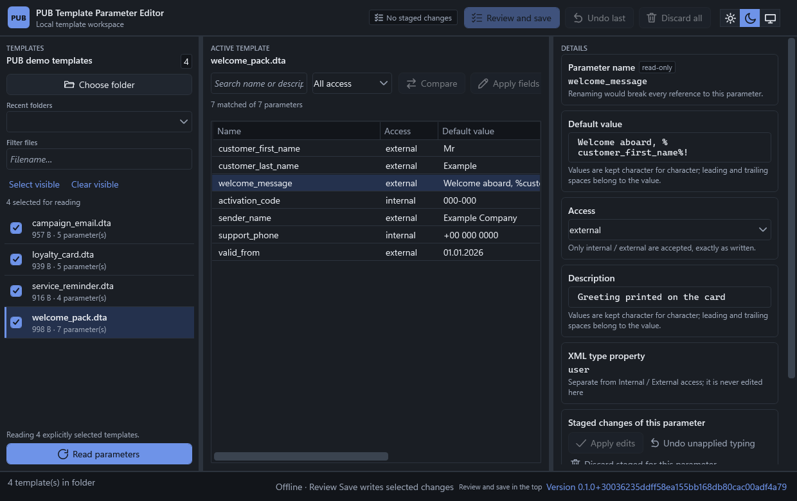
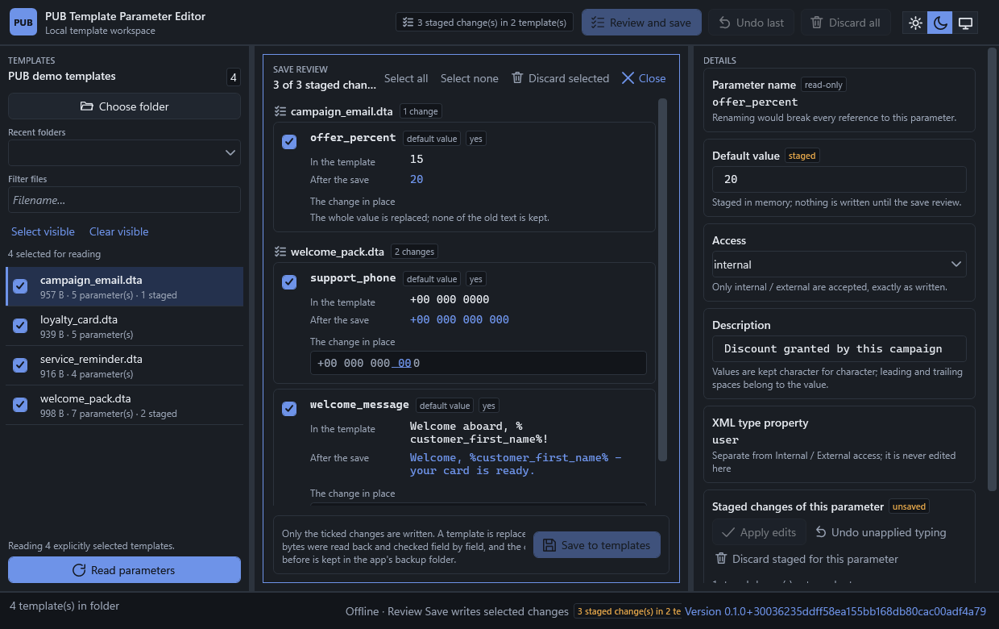

# PUB Template Parameter Editor

A Windows desktop editor for the variable declarations of PUB template files
(`.dta`). It is an offline tool: no service, no web view, no telemetry. Edits are
staged in memory and reach the disk only through an explicit review step.
It is distributed as one self-contained executable from a GitHub Release; that
build carries an Authenticode signature from the one certificate the project records, and its
SHA-256 — taken after signing — is published with the release.

The workspace in dark mode: the templates of one folder at the left, the declarations of
the selected template in the table, and the three editable fields of the selected
parameter at the right.



*Every name and value in the picture is invented:* the templates are synthetic `.dta`
containers written by `tests/PubTemplateEditor.App.Tests/ReadmeImageTests.cs`, which is
also what regenerates this image (`PUBTE_CAPTURE_README_IMAGES=1`). No real PUB template
is ever shown, and none is in this repository.

## What it does

- Lists the templates of one folder and reads their declarations without writing anything.
- Shows parameters in a table: name (read-only), internal/external access, description, default value.
- Stages value, access and description changes; Compare and bulk field application (each of the
  three fields on its own, matched by exact parameter name) work over the same stage.
- **Review Save** is the only write path: it lists every pending change per file, shows the
  change in place inside the full value, lets you select the rows to apply, and then patches the
  exact source spans of the XML — unrelated bytes and other container entries stay untouched.

  

  Review of three staged changes over two templates - nothing has been written yet, and
  only *Save* here touches a file.
- Keeps a timestamped backup and a recovery journal beside the user's settings; detects outside
  edits by content fingerprint before writing.
- Light and dark theme, resizable columns, remembered folders, drag-and-drop of a folder or a
  `.dta`, keyboard shortcuts.

## Layout

| Path | Contents |
| --- | --- |
| `src/PubTemplateEditor.Core` | domain model, template XML parsing, declaration reading, patch planning — no WPF, no file IO |
| `src/PubTemplateEditor.Infrastructure` | `.dta` container access, folder scan, read/write services, backups, settings |
| `src/PubTemplateEditor.App` | WPF shell, view models, themes, window frame tinting, embedded license texts |
| `tests/` | unit tests, integration tests (temp copies), WPF shell tests on an STA host |
| `packaging/` | MSIX manifest, tile assets, `build-msix.ps1` |
| `tools/brand/` | draws the application icon and tile artwork (see `NOTICE`) |
| `docs/` | setup, release and format findings |
| `.github/workflows/` | CI validation, release packaging and release publishing (all pinned by commit SHA) |

## Build and test

Requires the .NET 10 SDK (pinned by `global.json`) on Windows.

```powershell
dotnet restore PubTemplateEditor.slnx
dotnet build PubTemplateEditor.slnx -c Release
dotnet test  PubTemplateEditor.slnx -c Release

# portable single-file executable
dotnet publish src/PubTemplateEditor.App/PubTemplateEditor.App.csproj `
  -c Release -p:PublishProfile=PortableWin_x64 -o artifacts/publish/portable-win-x64

# optional: package the app locally (not a distribution channel)
powershell -File packaging/build-msix.ps1 -Version 1.0.0 -Mode Draft
```

The shipped artifact is `PUB_Template_Parameter_Editor.exe` - a single self-contained
file, attached to a GitHub Release. Packaging to MSIX is kept as local tooling for
running the app as a packaged app; it is not published, and no identity values exist
for it.

The program is called `PUB_Template_Parameter_Editor.exe` - the executable, the
assembly and (for a locally built package) the manifest entry all carry the product
name. Underscores instead of spaces keep the name usable on the command line, in
scripts and inside package paths.

The test suite prefers real PUB templates when the machine has them, and writes
synthetic containers of the same shape when it does not — see
`tests/TestSampleSupport.cs`. Before pushing, run the suite once with `examples/`
renamed away: that is what a fresh clone and CI see.

## Privacy, system changes, and signing

- **Privacy:** no user data or any other data are collected or transferred by this application, and
  nothing about your templates ever leaves the machine. It makes no request of its own: no service, no
  background check, no telemetry, licence texts included in the executable. The two exceptions both
  start with a click in the About window: a web link is handed to your own browser, and
  *Check for a new version* sends one anonymous request for the newest published version number and
  downloads nothing — you decide whether to open the release page it points to.
- **System changes:** it does not alter the system — no installer, no service, no
  startup entry, no registry change, no elevation. It writes only the template files
  you confirm in Review Save, plus its own files under `%LOCALAPPDATA%\PubTemplateEditor` (settings,
  backups, the recovery journal and a fault log).
- **Uninstall:** delete the program's folder.
- **Signed, and everything CI builds is not.** The executable attached to a GitHub Release is signed in
  a maintainer's session with the certificate recorded in `packaging/CertumSigning.settings.json`; the
  key sits in the signing service's own hardware, out of reach of any build agent. Read it with
  `(Get-AuthenticodeSignature .\PUB_Template_Parameter_Editor.exe).Status` — `Valid`, with a timestamp.
  A freshly published signed file can still draw a SmartScreen prompt until the file has reputation, so
  check the SHA-256 published with the release (taken after signing) before running it. Antivirus
  products may warn either way. One certificate signs this project's releases, and
  [docs/CODE_SIGNING.md](docs/CODE_SIGNING.md) says how it is used and what happens at renewal.

## Licensing

The copyright holder is named in [NOTICE](NOTICE) — the only personal datum this repository
publishes. Licensed under
**GPL-3.0-only** ([LICENSE](LICENSE)); see [NOTICE](NOTICE) for the notice that
accompanies the binaries, including the artwork provenance and the status of the
bundled .NET runtime, which is not relicensed.

## AI assistance and the instruction files

This application was written with the assistance of an AI coding agent, under the owner's direction
and review. A few files in the repository are instructions for that agent rather than program code
or user documentation, and they are published so the work stays reproducible and auditable:
`AGENTS.md` (standing rules the agent must follow), `CODEX_START_PROMPT.md` and `START_HERE.md`
(the original kickoff briefs) and `PLAN.md` (the agent's running record of what it changed, what it
actually verified, and which gates are still open). Anyone may hand the same files to an agent to
continue the work; the result is the owner's responsibility under the same licence.

## Documentation

- [CONTRIBUTING.md](CONTRIBUTING.md), [CODE_OF_CONDUCT.md](CODE_OF_CONDUCT.md), [SECURITY.md](SECURITY.md)
- [REQUIREMENTS.md](REQUIREMENTS.md), [ARCHITECTURE.md](ARCHITECTURE.md), [PLAN.md](PLAN.md)
- [docs/PROJECT_SETUP.md](docs/PROJECT_SETUP.md) — machine and solution setup
- [docs/RELEASE_PACKAGING.md](docs/RELEASE_PACKAGING.md) — CI, packaging, publishing a release, signing
- [docs/CODE_SIGNING.md](docs/CODE_SIGNING.md) — the one certificate, and what a signature proves
- [docs/GPL_RELEASE.md](docs/GPL_RELEASE.md) — source-availability obligations
- [docs/SAMPLE_FINDINGS.md](docs/SAMPLE_FINDINGS.md) — what the native templates look like
